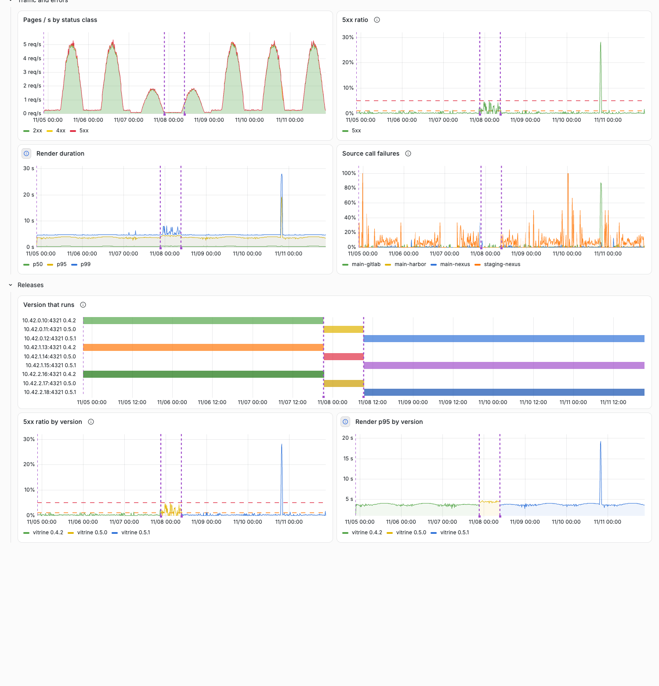
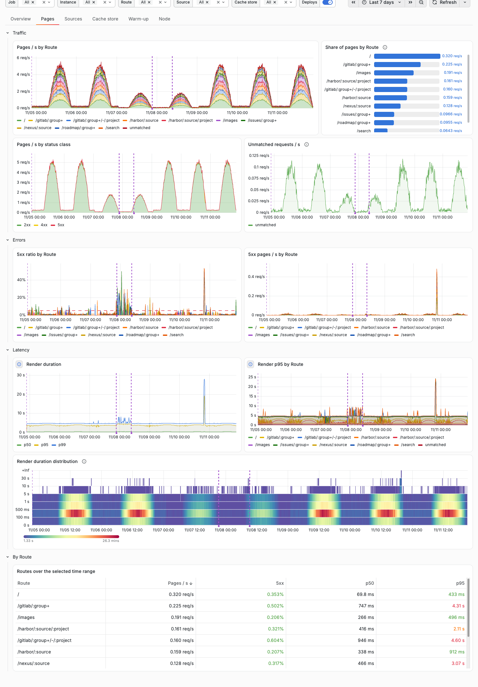
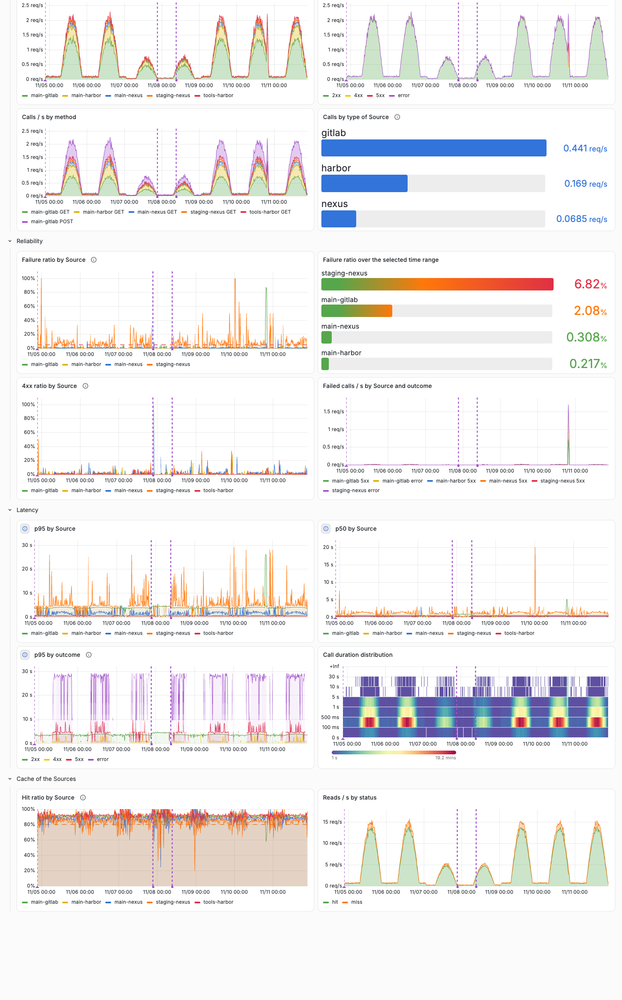
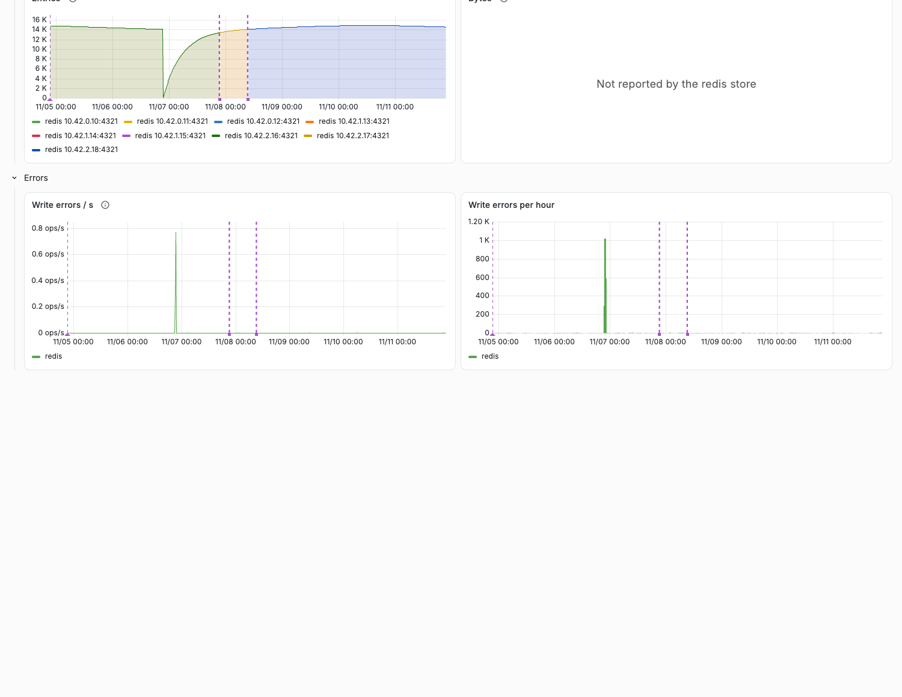
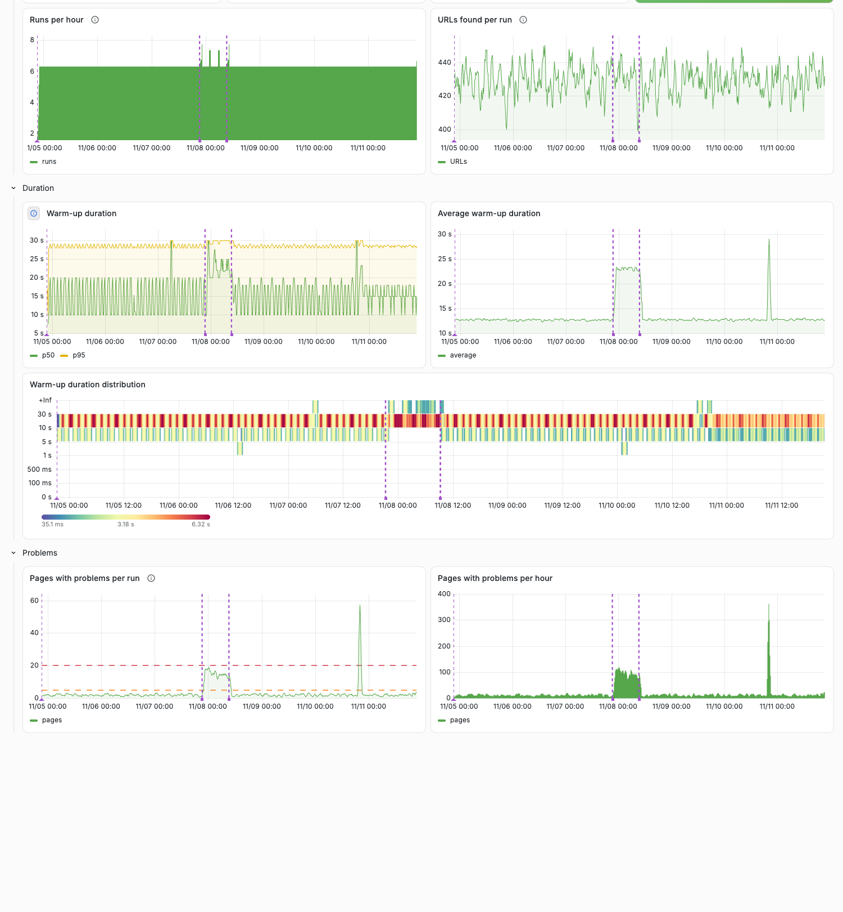
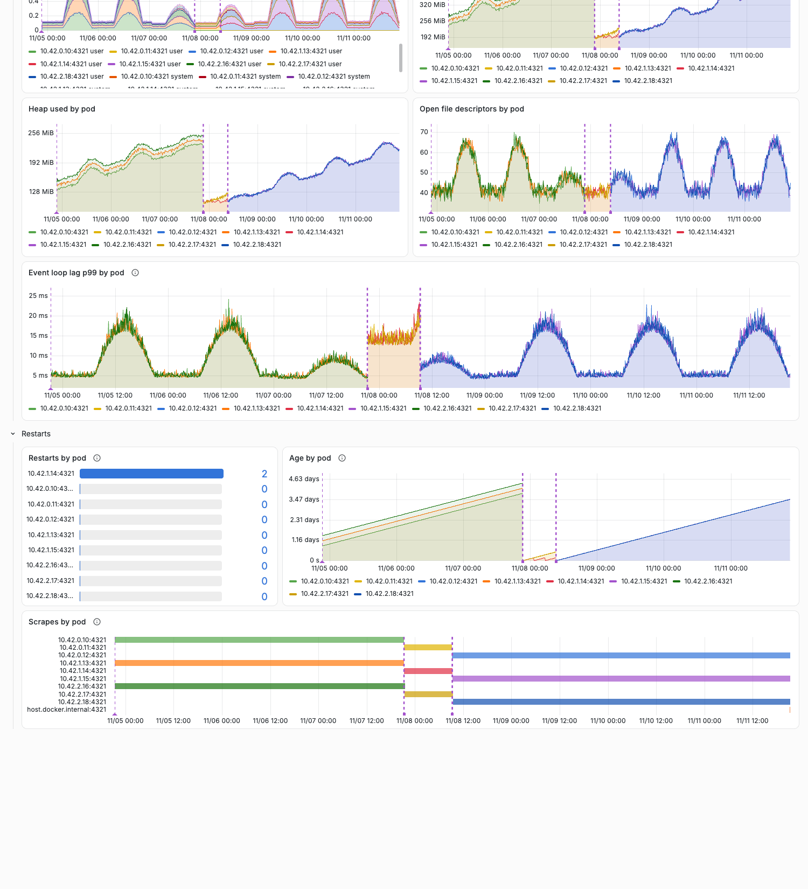
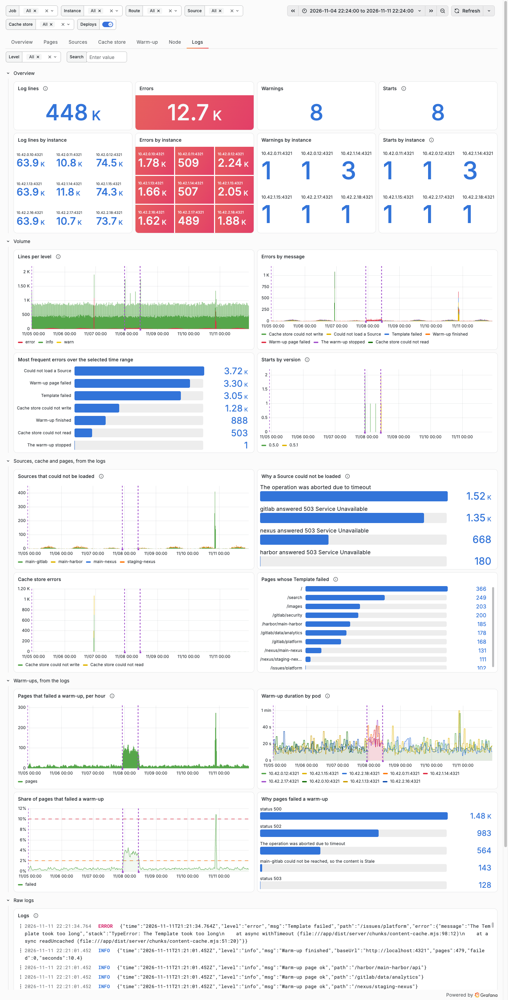

# Metrics

Vitrine serves Prometheus metrics at `GET /metrics`, or at `metrics.path`, in Prometheus text format, on the same port as its pages. They show how well the cache works, how long warm-ups take, how slow the Sources are, and how long pages take to render.

## Endpoint

- `metrics.enabled` in Settings, `true` by default. With `false`, the metrics are not served.
- `metrics.path` in Settings, `/metrics` by default: the URL they are served at. It must start with `/`, have no query, and not be `/` nor `/sitemap.xml`.
- A Route at `metrics.path` stops startup while `metrics.enabled` is `true`, as Vitrine serves that URL itself. With `false`, Vitrine leaves the URL to your Routes, and answers 404 when none uses it.
- `METRICS_TOKEN`, an environment variable. When it is set, a request without the header `Authorization: Bearer <token>` gets `401` with `WWW-Authenticate: Bearer`. When it is empty or unset, the endpoint is open. See [Security](security.md#metrics).
- `METRICS_BUCKETS`, an environment variable: the buckets of every histogram, in seconds, ascending and separated by commas. It defaults to `0.1, 0.5, 1, 5, 10, 30`. An invalid value, such as `5,1` or `fast`, stops startup with an error.

On Kubernetes, the [Helm chart](../../charts/vitrine/README.md#metrics) renders a Prometheus Operator `ServiceMonitor`.

## Build

| Metric | Type | What it counts |
| --- | --- | --- |
| `vitrine_build_info` | gauge | Always `1`, labelled with `version`: the `VITRINE_VERSION` the Container image sets, and `dev` from source. Graph a metric against it to tie a regression to a deploy, such as `rate(vitrine_http_requests_total{status_class="5xx"}[5m]) * on() group_left(version) vitrine_build_info`. |

## Cache

Labelled with `store`: `memory`, `files` or `redis`.

| Metric | Type | What it counts |
| --- | --- | --- |
| `vitrine_cache_entries` | gauge | Entries the store holds. `files` counts the entries in its directory, and `redis` the keys under its `keyPrefix`. |
| `vitrine_cache_bytes` | gauge | Their size in bytes. `memory` sums the JSON length of its entries, and `files` the size of its files. `redis` does not report it, as that takes a command per key. |
| `vitrine_cache_hits_total` | counter | Reads that found an entry, fresh or Stale. |
| `vitrine_cache_misses_total` | counter | Reads that found no entry, or failed. |
| `vitrine_cache_write_errors_total` | counter | Writes that failed. |

The two gauges walk the whole store: every file of `files` is read for its size, and `redis` scans every key of the server with `SCAN`, keeping those under its `keyPrefix`. So Vitrine measures at most every 30 seconds however often Prometheus scrapes, and measures again at the next scrape after it writes an entry itself. A Redis that other installations share, or a big cache, still pays that cost every 30 seconds.

## Source cache

Labelled with `source` (the type: `gitlab`, `harbor` or `nexus`), `name` (the name of the Source in Settings, so that two GitLabs, or a prod and a staging Nexus, can be told apart) and `status`: `hit` or `miss`.

| Metric | Type | What it counts |
| --- | --- | --- |
| `vitrine_source_cache_lookups_total` | counter | Reads of a Source through the cache. A `hit` was answered from a fresh entry. A `miss` called the Source, because the entry was missing or too old, or because `allowedAgeMinutes` is `0`. Visitors reading the same content at once share one read, which counts once. |

## Warm-up

Only the warm-ups the server runs from `warmUp` in Settings are measured, not those of `npm run warm-up`.

| Metric | Type | What it counts |
| --- | --- | --- |
| `vitrine_warmup_runs_total` | counter | Warm-ups run. |
| `vitrine_warmup_duration_seconds` | histogram | How long each took. |
| `vitrine_warmup_urls_found_total` | counter | Distinct URLs of Vitrine that warm-ups saw. |
| `vitrine_warmup_pages_with_problems_total` | counter | Pages whose list of problems was not empty. |

## Source HTTP calls

Labelled with `source` (the type: `gitlab`, `harbor` or `nexus`), `name` (the name of the Source in Settings), `method` and `outcome`: `2xx`, `3xx`, `4xx`, `5xx`, or `error` for a call that failed without an answer, such as a timeout. The path is not a label.

| Metric | Type | What it counts |
| --- | --- | --- |
| `vitrine_source_http_calls_total` | counter | Calls to a Source. |
| `vitrine_source_http_call_duration_seconds` | histogram | How long the Source took to answer. For a `2xx` answer, it runs until the body is read to the end, which is the slow part of a large page, and a body that fails halfway counts as `error`. Any other answer is timed until its headers. |

## Rendering and Node

| Metric | Type | What it counts |
| --- | --- | --- |
| `vitrine_http_requests_total` | counter | Pages requested, labelled with `route` and `status_class` (`2xx`, `3xx`, `4xx` or `5xx`). |
| `vitrine_render_duration_seconds` | histogram | How long a page took to render, with the same labels. A page with a Template is timed until it is complete; any other page streams, so it is timed until its response starts. |

`route` is the URL of the Route in Settings, such as `/nexus/:source`, never the URL requested. A request that matches no Route has `route="unmatched"`, which no Route URL can be, as they start with `/`. Vitrine's own pages, `/sitemap.xml` and the metrics, count for none. With these, `sum(rate(vitrine_http_requests_total{status_class="5xx"}[5m])) / sum(rate(vitrine_http_requests_total[5m]))` is the ratio of 5xx.

The default Node process metrics of `@prometheus-io/client` are served too, such as `process_cpu_user_seconds_total` and `nodejs_eventloop_lag_seconds`.

## Grafana board

A ready-made [Grafana](https://grafana.com/) board, in `.dev/grafana/dashboards/vitrine.json`, graphs these metrics, and the logs of Vitrine in [Loki](https://grafana.com/oss/loki/). It uses the tabs and rows of Grafana 13 (the v2 schema of its dashboards), so older versions cannot import it. The variables Job, Instance, Route, Source and Cache store filter every panel: Job tells installations of Vitrine apart, and Instance the pods of one. Leave them on All for the whole fleet. Deploys are marked on the graphs, from `vitrine_build_info`.

To try it with 7 days of fake metrics and logs, `docker compose -f .dev/compose.yaml up -d --wait` starts Prometheus, Loki and Grafana, then open <http://localhost:3000/d/vitrine>. [`.dev/README.md`](../../.dev/README.md) explains how it works and how to change the board.

**Overview**: the health of Vitrine at a glance, and which release caused a regression.

**Pages**: traffic, errors and render duration by Route.

**Sources**: calls, failures and latency of each Source, and how often the cache spares a call.

**Cache store**: hit ratio, size and write errors.

**Warm-up**: how long warm-ups take, and how many pages with problems they find.

**Node**: CPU, memory and event loop by pod, and the restarts of each.

**Logs**: the logs of Vitrine, which are one JSON object per line (see `LOG_LEVEL` in the [README](../../README.md)), and what they tell. The tab needs Loki, with `job`, `instance` and `level` as labels of each stream, as a collector such as Grafana Alloy gives them from the logs of a pod. It counts lines by level and by message, Sources that could not be loaded and why, Templates that failed, Cache store errors, and the duration and failures of warm-ups. At the bottom, the raw lines: filter them with Level and with Search, a case-insensitive regular expression, and click a line for its fields.

These screenshots show the fake metrics and logs of `.dev`: a rolling deploy to a bad release (0.5.0) and its hotfix, a flushed Redis, and a GitLab outage.
